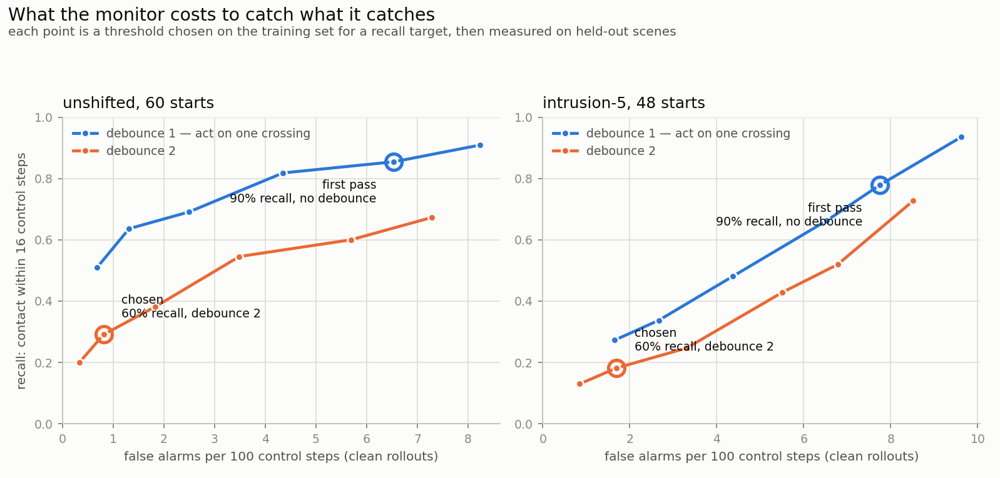

# FastVLA-Eval

FastVLA-Eval is a fast and correct closed-loop evaluation harness for vision-language-action
(VLA) policies on LIBERO-Safety. It aims to make closed-loop evaluation substantially faster
than the current single-environment driver — parallel simulation workers against a batched
policy server, with a C++ clearance labeler and the LIBERO-Safety scoring fixes built in —
without changing results, and to prove that with per-start verdict checks against a
reference run and statistical equivalence checks in fast mode. All performance and accuracy numbers are
pending the audit; nothing here is measured yet.

Author: Varun Chandra

## Benchmark

<!-- BENCH TABLE START -->
Every row measured on **RTX A5000 (GPU 1 of 2)**, driver **530.30.02**, torch **2.2.0+cu121** (constant across rows -- one box, one environment). The commit column is the commit that last touched that row's artefact, i.e. when the number was last measured. Reproduce with `make bench`.

| metric | before | after | how measured | commit |
|---|---|---|---|---|
| rollouts per hour, 60-start eval, 1 GPU | 71.2 (M0, single process) | **544.8** | `bench/bench_all.sh` → `bench/out/m4_t1_summary.json` | `28deac3` |
| ms per control step, per worker | 190.3 (M0, one process) | 197.7 | wall x N_workers / total steps; above M0 because 8 workers contend | `28deac3` |
| GPU utilisation during eval | 9.9% (M0) | 85.4% | `nvidia-smi dmon -s um`, 1 Hz → `bench/parse_dmon.py` | `28deac3` |
| clearance labeler, ms per call | 63.64 | **0.578** | `bench/call_run.sh` → `bench/out/m2_call_*.json` | `348ba38` |
| clearance labeler, µs per hull pair | 634 | 5.7 | same, exact pairs counted per call | `348ba38` |
| contact scan, ms per control step | 8.19 | **2.25** | `audit/t2_run.sh` CONTACTS=0 vs 1, identical instrumentation | `e902380` |
| policy forward, ms per call (B=1) | — | 167.97 | `bench/fwd_run.sh time baseline` | `28deac3` |
| forward phases: LLM / vision | — | 130.2 / 33.9 ms | same run, CUDA events per submodule | `28deac3` |
| per-request: queue / forward / transport | — | 798.1 / 184.2 / 25.9 ms | worker round trip minus server-reported parts | `28deac3` |
| serving layer: ZeroMQ vs Triton 23.07 | 544.8 roll/h | 511.2 roll/h | `bench/triton_serve.sh` + `POLICY_TRANSPORT=triton` | `3d8cc12` |
| in-container (Apptainer) 60-start | 544.8 roll/h (host) | **547.5 roll/h** | `bench/incontainer_run.sh` | `02aa037` |
| cold start, server start → READY | — | 15.0 s | same run, image pull excluded | `02aa037` |
| correctness: collisions / completions | 29 / 26 (M0 reference) | **29 / 25** | `bench/accept.py` (requires 29, and 25 or 26) | `28deac3` |
| correctness: per-start collision flips | — | **0** | same, against the M3 N=16 reference | `28deac3` |
| correctness: max per-start clearance difference | — | 0.1530 cm | same | `28deac3` |
| labeler stage split (python): union-hull GJK / exact pairs | — | 22.5 / 40.2 ms | `bench/stages_run.sh` | `b9a22b7` |
<!-- BENCH TABLE END -->

Every cell is read from a JSON artefact under `bench/out/` that a bench script wrote;
`make bench-check` fails if the table and the artefacts disagree. `make bench` regenerates
both.

## What is where

| path | what |
|---|---|
| `fastvla/labeler/` | the GJK clearance labeler: C++17 core, pybind11 bindings, `DESIGN.md` |
| `fastvla/server/` | the policy server (ZeroMQ and Triton), `DESIGN.md`, `FORWARD.md`, `CONTAINERS.md` |
| `fastvla/sim/` | the simulator worker: one MuJoCo environment per process |
| `fastvla/eval/` | manifests and the run orchestrator |
| `fastvla/monitor/` | the runtime collision monitor: activation capture, the probe, `EVAL.md` |
| `audit/` | the M0 audit: `AUDIT.md`, its scripts, and the single-environment assumption list |
| `bench/` | every benchmark, and `accept.py`, the correctness gate each change must pass |
| `deploy/` | Dockerfile (GPU and CPU), compose file, Kubernetes manifests |
| `tests/` | the CPU suite: GJK parity, metrics format, source guards |

## Runtime collision monitor

A linear probe on the policy's own activations, read at every forward, built into the
server. `MONITOR=off|log|stop`, off by default. Full results and method in
[`fastvla/monitor/EVAL.md`](fastvla/monitor/EVAL.md).

| | unshifted (60) | intrusion-5 (48, never trained on) |
|---|---|---|
| Spearman to true clearance, pre-contact | +0.868 | +0.480 |
| AUROC, contact within 8 / 16 / 32 control steps | 0.918 / 0.807 / 0.756 | 0.743 / 0.670 / 0.630 |

The operating point is a threshold (+1.2979, the one giving 60% recall at k=16 on the
training set) plus a **debounce of 2** — act only on two consecutive alarming forwards.
It sits at the knee of the recall / false-alarm curve:

| at that point | unshifted | intrusion-5 |
|---|---|---|
| collisions alarmed before contact | 18 of 29 | 12 of 40 |
| clean rollouts raising any alarm | 18 of 31 | 7 of 8 |
| **false alarms per 100 control steps** | **0.81** | 1.69 |

`MONITOR=log` costs **0.067 ms per forward**, 0.037% of a 183.4 ms forward, and runs at
**546.2 rollouts/hour against the 544.8 baseline** — within noise. It passes the 60-start
acceptance unchanged: 29 collisions, 25 completions, **zero collision flips on 60 starts,
completions within the run-to-run floor (0 to 1)**, max per-start clearance difference
0.0000 cm. That floor is measured in
[EVAL.md section 7](fastvla/monitor/EVAL.md): two runs of the same manifest in the same
configuration can differ, because the policy forward is not bit-reproducible run to run.

**`MONITOR=stop` is a brake, not an avoidance.** It zeroes the pose delta and holds the
gripper for the rest of the rollout; it has no notion of which direction is safe and it
never resumes.

| | collisions | completions | rollouts braked | median first hold |
|---|---|---|---|---|
| unshifted, 60 starts | 29 → **11** | 25 → **12** | 46 of 60 | control step 92 |
| intrusion-5, 48 starts | 40 → **28** | 4 → **0** | 43 of 48 | control step 88 |

No start was made worse — zero newly-colliding starts in either set. On the unshifted set
it prevents 18 collisions and loses 13 completions, which is the trade the brake actually
offers. On the shifted scenes it is much weaker (12 of 40 prevented, all 4 completions
lost): the probe transfers poorly to geometry it never saw, and the brake fires late.

An earlier pass ran `stop` at a 90%-recall threshold with no debounce. It braked **every**
rollout at a median of control step 8, taking collisions to 1/60 and completions to 1/60 —
the arm stopped moving almost before it started. EVAL.md section 9 keeps both runs, because
the contrast is the argument for the operating point above.

As background, the research tree's probe-gated *steering* (a different intervention, not
re-run for this milestone) reports 14/60 collisions and 18/60 completions against the
same 29/25 baseline: 0 rescued, 3 lost.

## Correctness

Every change is gated by `bench/accept.py` on the 60 fixed starts: **29 collisions**,
completions in **{25, 26}**, and **zero per-start collision-verdict flips** against a
reference run. The aggregate counts alone are not enough — M3 produced a configuration
with the right totals and four flipped collision verdicts that happened to cancel, and
that is what the per-start check exists to catch.

Changes rejected on these grounds, with the measurements, are in
`fastvla/server/FORWARD.md` (M4: every candidate rejected, including a `torch.compile`
that won its microbenchmark by 6.7% and lost 15% end to end) and
`fastvla/server/DESIGN.md` (M3: dynamic batching).
