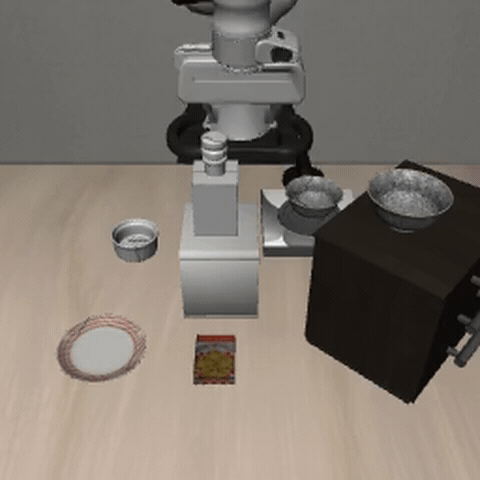
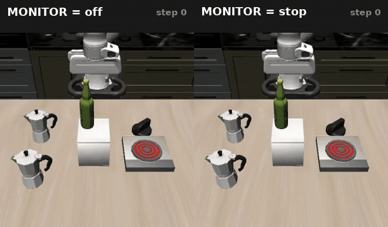

# FastVLA-Eval

**A fast, trustworthy test bench for robot-control AI models, plus a warning light that
predicts a crash before it happens.**

Robots are now driven by large AI models, the same kind that write text. Before anyone
trusts one near real objects, it is tested in simulation. You run the task hundreds of
times and count how often the arm hits something. That test used to take most of an hour,
with the expensive graphics card idle almost all of it. This tool runs the same test in
seven minutes. It returns the same answer on every single trial. It also adds a warning
light: a cheap read of the model's own internal signals that sees a crash coming.

## What you get

### A faster test bench

The standard test is 60 trials. It took **51 minutes**. It now takes **7 minutes** — a
**7.6×** speed-up. Every trial still gets the same verdict: hit, or no hit.

<p align="center">
  
</p>

<sub>One trial: the arm completes the task without touching the obstacle. Closest approach
5.84 cm. Shown at 1.6× speed.</sub>

How, in two steps. The slow part was never the AI model. It was the geometry that
measures how close the arm is to each obstacle. That ran in Python, twice per step;
rewriting it in C++ made it **110× faster**. Then eight simulated kitchens run at once,
sharing one copy of the model on one card.

Full table, every number traceable to the file that produced it:
**[docs/BENCHMARK.md](docs/BENCHMARK.md)**.

### A warning light

The model's internal activations already know how close the arm is to the obstacle. A
small linear read of them predicts a collision before it happens, for almost nothing.

The model is asked for actions eight at a time. Those eight are one *chunk*, and each
one is a *control step*.

- **AUROC 0.918** for contact within the next chunk. (AUROC is how well a score separates
  two cases: 1.0 is perfect, 0.5 is a coin flip.)
- **74 control steps** of warning before contact, median. A whole task takes about 300.
- **0.067 ms** per model call, which is 0.04% of one call.

Wired to an automatic stop, on the 60 trials: **18 of 29 collisions prevented, none
created, 13 tasks left unfinished.**

<p align="center">
  
</p>

<sub>The same trial run twice, nothing changed but the setting. Left, the arm knocks the
bottle over at step 129. Right, the warning light fires and the arm is held from step 128,
one step earlier, and stays held. Closest approach 1.59 cm.</sub>

It stops the arm where it is. It does not steer around the obstacle, and it never resumes.
That is a real limit, not a detail: a trial it saves is a trial it also ends.

Method, metrics and the full stop results: **[fastvla/monitor/EVAL.md](fastvla/monitor/EVAL.md)**.

## How we know the answers did not change

Every change is checked trial by trial against the original harness, not on totals. Two
speed-ups were genuinely faster and were switched off anyway: batching requests, and
compiling the model. Each changed the verdict on 3 to 5 of the 60 trials. One of them
even matched the correct totals while getting four individual trials wrong, which is
exactly why the check is per trial. The full gates, the rejected changes and the
reproducibility floor are in **[docs/CORRECTNESS.md](docs/CORRECTNESS.md)**.

## Try it

```bash
git clone git@github.com:alpha9centauri/fastvla-eval.git && cd fastvla-eval
python -m pip install -e .     # installs the package; it declares no dependencies
make labeler                   # compiles the C++ geometry core
make test                      # 55 checks, no graphics card needed, a few seconds
make bench-quick               # the end-to-end timings, about 8 minutes on a GPU
```

Running trials needs a graphics card, the simulator and a model checkpoint. None of those
are included here. `docs/ARCHITECTURE.md` explains what talks to what;
`docs/BENCHMARK.md` has the full table.

## Limits

- The warning light is fitted to this one model and this one benchmark; on scenes it never
  saw, its accuracy drops by about half.
- The automatic stop is a brake, not avoidance — it halts the arm and costs finished tasks.
- The Kubernetes manifests in `deploy/` have never been run against a cluster.

## Acknowledgements

- [LIBERO-Safety](https://github.com/LIBERO-SAFETY/LIBERO-Safety) and
  [LIBERO](https://github.com/Lifelong-Robot-Learning/LIBERO), for the benchmark.
- [OpenVLA-OFT](https://github.com/moojink/openvla-oft), for the model.
- [openpi](https://github.com/Physical-Intelligence/openpi), for the serving patterns.
- **Heng Zhang** and the **Safe AI Lab at Carnegie Mellon University**, for the research
  this was built to serve.

## Licence

MIT, see [LICENSE](LICENSE). Third-party components keep their own licences, listed there.
How every external fact and version in this repository was checked is recorded in
[docs/PROVENANCE.md](docs/PROVENANCE.md).
