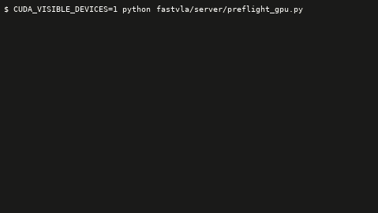

# How it works

One evaluation run is sixty trials. Each trial is a simulated kitchen, a task, and up to
300 control steps. At every step the robot's cameras and joint positions go to a large
model, which returns the next eight actions.

The original harness ran one simulator in one process and called the model in the same
process. The model is large, so the simulator waited; the simulator's obstacle-distance
geometry was slow, so the model waited. The card sat idle about 90% of the time.

This harness splits the two apart. Many simulators run at once as separate processes. One
server holds the single copy of the model on the GPU and answers all of them.

```
  manifest: 60 (task, start, obstacle placement) triples, fixed
        |
        v
  +-----------------------------------------------+
  |  runner: spawns N workers, one shared server   |
  +-----------------------------------------------+
        |                                     |
        v                                     v
  8 x simulator worker                  policy server (1 GPU)
  +---------------------------+         +------------------------------+
  | MuJoCo env (one process)  |  ZeroMQ | receiver thread: preprocess  |
  | observation --------------+-------->| (crop, normalise, tokenise)  |
  |                           |  ipc:// |            |                 |
  | C++ GJK labeler:          |         |            v                 |
  |   clearance + contact,    |         | forward thread: one GPU      |
  |   0.578 ms per call       |         | forward per batch            |
  |                           |         |            |                 |
  |                           |         |   +--------+---------+       |
  | 8-step action chunk <-----+---------+---| monitor: probe on |      |
  +---------------------------+         |   | the activations   |      |
        |                               |   +-------------------+      |
        v                               +------------------------------+
  per-rollout npz: eef, clearance,
  contact, actions, activations
        |
        v
  bench/accept.py: 29 collisions, 25-26 completions,
  ZERO per-start collision-verdict flips -- or the change is rejected
```

The pieces, in the order a request meets them:

- **The runner** (`fastvla/eval/`) reads the manifest, starts the server, spawns the
  workers, and merges their results when they finish.
- **The worker** (`fastvla/sim/`) owns one simulator. It steps the physics, asks the
  server for actions, and records every step to disk before it exits.
- **The labeler** (`fastvla/labeler/`) computes the distance from the robot to each
  obstacle, twice per control step. It is C++ because in Python it cost more than the
  model did.
- **The server** (`fastvla/server/`) holds the model. A receiver thread preprocesses
  arriving requests while a forward thread runs the GPU, so the two overlap.
- **The monitor** (`fastvla/monitor/`) reads the model's own activations between the
  forward and the reply, so a stop decision affects the very actions that triggered it.

<p align="center">
  
</p>

<sub>A real run of the 10-start gate set on GPU 1, replayed at 12.5× — the GPU pre-flight
that refuses to start on the wrong card, the server coming up, eight workers, and the
throughput counter as trials land. These ten starts all collide and run to the 300-step
cap, so they are slower than the 60-start figure. The transcript it was rendered from is
`media/harness_session.txt`; the renderer is `bench/render_terminal_gif.py`.</sub>

## Why batch size one

The server can batch requests from several workers into one GPU forward, and that is
faster. It is off, because at batch sizes above one the reduction order inside the
bf16 matrix multiplies changes with batch composition, actions change by up to 6.6e-3,
and trials in contact-marginal scenes diverge. See `docs/CORRECTNESS.md`.

The throughput therefore comes from running many simulators, not from batching.

## Deeper reading

| file | what |
|---|---|
| `fastvla/labeler/DESIGN.md` | the GJK distance core, its parity against Python, the compiler flags rejected |
| `fastvla/server/DESIGN.md` | the two-thread server, the batching sweep, the Triton comparison |
| `fastvla/server/FORWARD.md` | every forward optimisation tried, with the numbers, all rejected |
| `fastvla/server/CONTAINERS.md` | unprivileged Apptainer on a host without root, and why Docker is not usable there |
| `fastvla/monitor/EVAL.md` | the collision monitor: fitting, metrics, operating point, stop results |
| `audit/AUDIT.md` | the original measurement that redirected the project |
